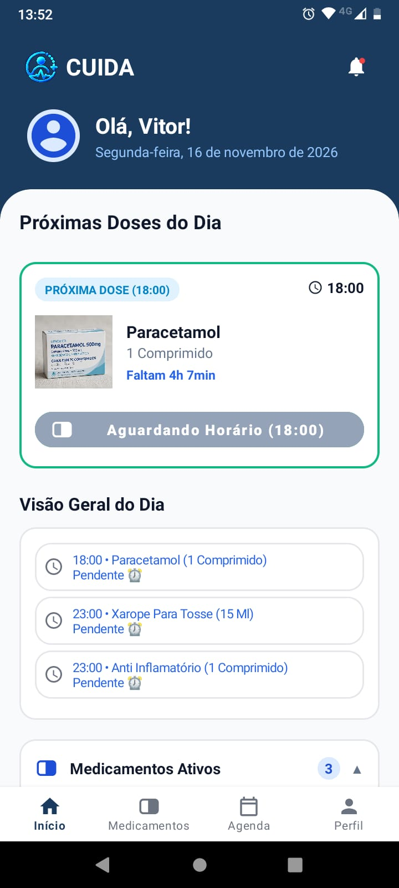
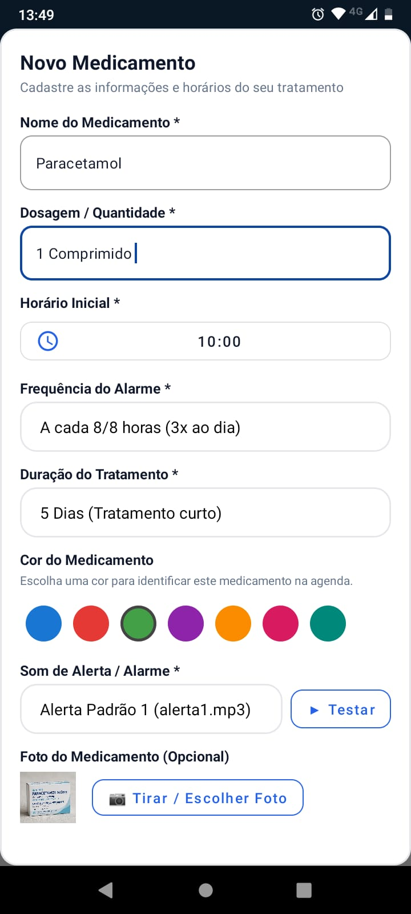
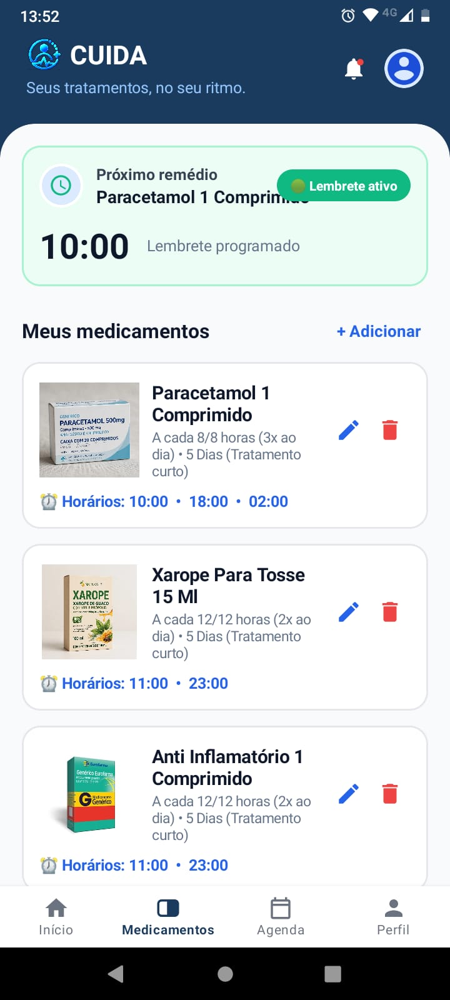
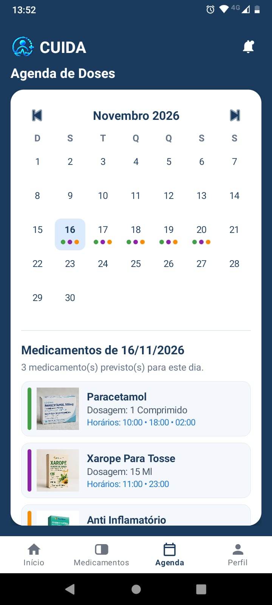
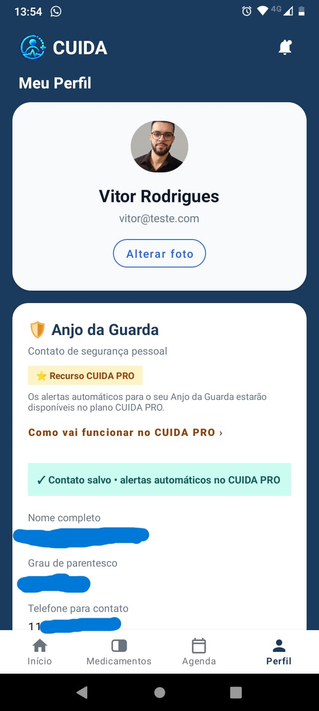

# CUIDA — Controle Unificado Inteligente de Autocuidado

Aplicativo Android nativo desenvolvido para ajudar na organização da rotina de medicamentos e autocuidado, com foco em privacidade local, funcionamento offline dos lembretes e suporte para situações de emergência.

---

## 📱 Download (Somente Android)

> **Disponível exclusivamente para dispositivos Android.**

O instalador oficial (`Cuida-debug.apk`) está disponível na página de Releases deste repositório.

👉 **Acesse a página de download:** [CUIDA v1.0.0 (Releases)](https://github.com/VitorRodrig15/App-Cuida-Controle-Unificado-Inteligente-de-Autocuidado/releases/tag/v1.0.0)

### Como instalar no celular:

1. Toque no botão azul ou no link acima para abrir a página da versão **v1.0.0** no GitHub.
2. Role até a seção **Assets** e toque em **`Cuida-debug.apk`** para baixar o instalador.
3. Ao abrir o arquivo baixado no celular, o Android solicitará permissão para **instalar apps de fontes desconhecidas** (ou do navegador utilizado). Autorize para prosseguir.
4. Conclua a instalação e abra o **CUIDA**.

*Nota: Como esta é uma versão de testes (`debug`), o Google Play Protect pode exibir um aviso padrão perguntando se você deseja instalar mesmo assim — basta tocar em **Instalar assim mesmo**. No primeiro acesso, conceda as permissões de **Notificações** e **Alarmes e lembretes** para que os alertas toquem no minuto exato.*

---

## ✨ Funcionalidades Principais

- **Gestão de Medicamentos:** Cadastro com nome, dosagem, horário inicial, frequência (6h, 8h, 12h ou 24h), duração (5, 7, 14, 30 dias ou uso contínuo), cor de identificação, foto e som personalizado.
- **Alarmes Dedicados:** Alertas sonoros que utilizam o volume de alarme do aparelho (como um despertador), funcionam com a tela bloqueada, entram em fila quando há doses simultâneas e permitem confirmar (*Tomei*) ou adiar por 10 minutos.
- **Registro Fotográfico:** Possibilidade de anexar uma foto (câmera ou galeria) para registrar a tomada de uma dose específica.
- **Agenda e Histórico:** Visualização do calendário de tratamentos ativos e histórico recente de doses confirmadas ou não respondidas.
- **Ficha Médica e Exportação em PDF:** Armazenamento de dados de saúde (tipo sanguíneo, alergias, condições médicas, peso, altura e doação de órgãos) com geração de **Ficha Médica em PDF** diretamente no aparelho para compartilhamento rápido.
- **Anjo da Guarda:** Cadastro de um contato de confiança com telefone e parentesco exibido no perfil e na Ficha Médica *(recursos de alertas automáticos e SOS previstos para a versão CUIDA PRO)*.
- **Multiusuário Isolado:** Suporte para mais de uma conta no mesmo aparelho, mantendo os dados locais e os agendamentos de alarme separados por usuário.

---

## 📸 Prévia do Aplicativo

Conheça algumas das principais telas do **CUIDA**, com exemplos reais de utilização e visualização das funcionalidades disponíveis no aplicativo.

### 🏠 Tela Inicial

Visão geral dos próximos medicamentos, horários programados e acompanhamento das doses do dia.

| Tela inicial |
|:---:|
|  |

---

### 💊 Cadastro e Gerenciamento de Medicamentos

Cadastro personalizado de medicamentos, com dosagem, frequência, duração do tratamento, horário inicial, cores, sons de alerta e fotografia.

| Cadastro de medicamentos | Lista de medicamentos |
|:---:|:---:|
|  |  |

---

### 📅 Agenda de Doses

Calendário interativo para acompanhar os tratamentos, identificar dias com medicamentos programados e consultar os horários de cada dose.

| Agenda de doses |
|:---:|
|  |

---

### 👤 Perfil do Usuário

Área de perfil com informações da conta e cadastro do contato de segurança pessoal, e relatório geral como altura, peso, tipo sanguíneo, alergia;
Além de Relatório Gerado em PDF*.

| Perfil do usuário |
|:---:|
|  |

---

## 🔒 Privacidade e Arquitetura de Dados

O CUIDA foi projetado sob o conceito **Local-First** para dados sensíveis, em conformidade com a LGPD (Lei nº 13.709/2018):

- **Armazenamento 100% Local:** Medicamentos, histórico de doses, fotos, áudios personalizados, informações de saúde e o contato do Anjo da Guarda ficam gravados **exclusivamente na área privada do aparelho** (fora do backup automático na nuvem).
- **Funcionamento Offline:** O agendamento e o disparo dos alarmes funcionam sem conexão com a internet.
- **Autenticação Segura:** Apenas os dados cadastrais básicos (nome, CPF, e-mail e registro de aceite dos termos) são sincronizados via **Google Firebase (Authentication e Cloud Firestore)** para login, recuperação de senha e exclusão de conta.
- **Zero Rastreamento:** O aplicativo não exibe anúncios, não coleta localização em segundo plano e não utiliza ferramentas de analytics ou venda de dados.

📄 **Documentação Legal:** Leia os [**Termos de Uso e Política de Privacidade**](https://github.com/VitorRodrig15/App-Cuida-Controle-Unificado-Inteligente-de-Autocuidado/blob/main/termos_de_uso_e_politica_de_privacidade.md) (também disponíveis dentro do aplicativo em *Perfil → Termos de uso*).

---

## ⚠️ Aviso Importante

O CUIDA é uma ferramenta de apoio à organização pessoal e **não substitui** consultas, diagnósticos, prescrições médicas ou serviços de emergência. Em caso de urgência médica, ligue **192 (SAMU)**.

---

## 🛠️ Tecnologias Utilizadas

- **Plataforma:** Android Nativo (Kotlin / Android Studio)
- **Backend e Autenticação:** Firebase Authentication & Cloud Firestore
- **Recursos Nativos:** AlarmManager (alarmes exatos), Foreground Services, CameraX / Galeria e geração nativa de PDF
